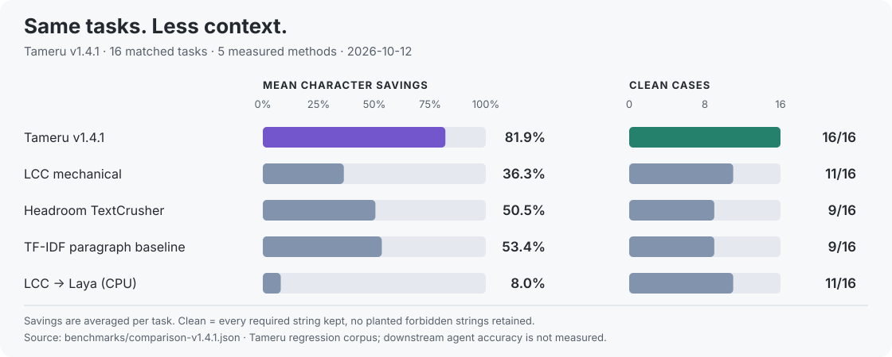

# Tameru (貯める)

<p align="center">
  <br><br>
  <a href="CHANGELOG.md"></a>
  <a href="pyproject.toml"></a>
  <a href="pyproject.toml"></a>
  <a href="tests/"></a>
  <a href="benchmarks/production-qa-v3-results.json"></a>
  <a href="LICENSE"></a>
</p>

**Less context. More room for your agent to work.**

Tameru is **query-aware context compaction for LLM agents**. It turns bulky tool outputs, logs and documents into smaller extracts while keeping the source evidence relevant to the task: the error, the definition, the current configuration, or the relationship connecting a question to its answer.

The default engine runs locally with **no LLM call, no GPU and no runtime dependencies beyond Python's standard library**. It preserves selected source text, collapses repetition and can return the original input when the query gives too little signal. Optional recovery lets an integrated host retrieve omitted context later.

<!-- tameru:headline:start -->

| Mean characters saved | Required strings retained | Forbidden strings retained | Median wall time |
|:---:|:---:|:---:|:---:|
| **81.9%** | **25/25** | **0** | **12.83 ms** |

Recorded on **16 shared task cases**, with 5 runnable methods on CPU, **2026-10-12**, on Tameru v1.4.1. Tameru v1.5.0 returns byte-identical output on all 16 cases, so these scores are v1.5.0's; only speed changed. These are source-evidence checks on Tameru's regression corpus; agent answer accuracy and model-token costs are outside this evaluation.

<!-- tameru:headline:end -->

[Performance](#comparison-with-other-approaches) · [See it work](#see-it-work) · [Quickstart](#quickstart) · [Hermes](#hermes) · [What's in 1.5.0](#whats-in-150) · [Documentation](#documentation)

## Comparison with other approaches

<!-- tameru:comparison:start -->

**Same input. Same query. Same 16 tasks.** The comparison covers documents, configuration, Git/npm/YAML output, multilingual text and saturated grep, captured pytest and numbered-source cases.



| Method | Required strings kept | Forbidden strings ↓ | Clean cases | Mean chars saved ↑ | Median wall time ↓ |
|---|---:|---:|---:|---:|---:|
| **Tameru v1.4.1** | 25/25 | 0 | 16/16 | 81.9% | 12.83 ms |
| LCC mechanical | 25/25 | 5 | 11/16 | 36.3% | 6.97 ms |
| Headroom TextCrusher | 21/25 | 4 | 9/16 | 50.5% | 0.51 ms |
| TF-IDF paragraph baseline | 22/25 | 5 | 9/16 | 53.4% | 0.12 ms |
| LCC → Laya (CPU) | 25/25 | 5 | 11/16 | 8.0% | 8,091.08 ms |
| LCC → JEV — unmeasured | — | — | — | — | — |

**A clean case keeps every required string and excludes every planted forbidden string.** Savings are the arithmetic mean per case; wall time is the median of per-case medians. Headroom's row measures the **TextCrusher component**. JEV was unmeasured because its API credential was unavailable.

**Version note.** Every row, including Tameru's, was measured together on v1.4.1, so the timings are comparable with one another. Tameru v1.5.0 passes `python benchmarks/compare.py --verify-against benchmarks/comparison-v1.4.1.json`: the same corpus, with identical output hashes, savings and retention on all 16 cases. The competitors were not re-run, and Tameru's timing is not restated for v1.5.0, so the table never mixes runs from different machines.

[Complete comparison and per-task results →](benchmarks/COMPARISON.md) · [Raw measurements →](benchmarks/comparison-v1.4.1.json)

<details>
<summary><strong>Evaluation details: corpus, methods, timing and limits</strong></summary>

**Corpus.** All scored methods see identical text and task queries. The 16 cases include 25 required source strings plus planted stale, excluded or distracting strings. The large synthetic performance case and empty-query case belong to the separate release QA battery.

**Metrics.** Required strings must survive every output; a forbidden string in any output counts as a leak. Character savings measure text length, rather than model tokens or monetary cost. These checks cover specified fixture evidence and do not measure downstream agent answers or every possible semantic loss.

**Methods.** Tameru uses default extraction with `ccr=False`, `citations=True`. LCC 1.0.0 uses one scoring worker and no marker; Headroom 0.40.0 uses Rust TextCrusher at defaults, without the full router or recovery store. TF-IDF is a simple paragraph-retrieval baseline. Laya 0.4.4 runs its pinned multilingual model on CPU. LCC's protected no-ops are valid policy outcomes; model fallbacks receive no score.

**Timing.** One untimed warmup and 3 timed complete calls per case. Parsing, scoring and rendering are inside the timer; imports and model loading are outside it. All 5 scored methods produced identical output across the warmup and timed repeats. Hardware and scheduling affect latency. Tameru v1.5.0 remembers analyses of repeated identical text, so this repeat-timing protocol flatters it; its first-call (cold) speed-up is in [What's in 1.5.0](#whats-in-150).

**Runtime and provenance.** Python 3.12.14 on INTEL(R) XEON(R) PLATINUM 8573C, with CPU-quota and thread settings in the JSON. Source/model pins, input/output hashes, package versions and individual timing samples are recorded in the raw JSON. The resumed Laya measurements retain the same corpus and settings; execution segments record the protected-no-op classification correction.

**Interpretation.** This is Tameru's own regression corpus, including adversarial fixtures. Broader independent and live-agent evaluations are still needed to establish generality. An unmeasured provider has no score carried forward from an earlier release.

</details>

<!-- tameru:comparison:end -->

## See it work

**Task:** “Which database endpoint does Project Orion use?”

The answer sits behind a relationship: **Project Orion → warehouse Cedar → endpoint DB-EU-7**. Sixty routine archive paragraphs surround the two useful facts. The endpoint line never names Project Orion.

| Original context | Tameru extract | Estimated token savings |
|---:|---:|---:|
| 5,342 characters | **266 characters** | **95.0%** |

Actual output, with recovery storage and citations disabled:

```text
Routine archive section 0: ordinary status record with no relevant operational facts.
[…]
Project Orion uses warehouse Cedar.
[…]
Cedar routes writes through endpoint DB-EU-7.
[…]
Routine archive section 29: ordinary status record with no relevant operational facts.
```

Both connecting facts survive. The retained boundary paragraphs and omission markers make the extract readable. [Run the complete example](#python), or inspect the [fixture](benchmarks/run_battery.py).

<details>
<summary><strong>Show the original input structure</strong></summary>

```text
Routine archive section 0: ordinary status record with no relevant operational facts.
... 29 more routine archive paragraphs ...

Project Orion uses warehouse Cedar.

Cedar routes writes through endpoint DB-EU-7.

... 30 more routine archive paragraphs ...
```

This is an excerpt of the input structure; the Python example below constructs all 60 archive paragraphs.

</details>

## Where Tameru helps

| Your agent is reading… | Tameru focuses on… |
|---|---|
| Pages of logs around a failure | Error fingerprints, relevant messages, hosts and ports |
| Search results repeating the same name | Matching definitions and assignments, distinct matches and file context |
| A failed test with long captured output | The failure, recognised errors, warning-or-higher lines and section boundaries |
| Configuration containing an old value and a later override | The current value and its qualifier when supersession is explicit |
| A document with an answer spread across sections | Related entities and the source facts linking them |
| Git history, JSON, CSV or YAML dumps | Relevant records with enough structure to interpret them |

### Formats and languages

| Input | Handling |
|---|---|
| Terminal and build logs | ANSI handling, repeated-template reduction, error exemplars and last-occurrence retention |
| Numbered source reads | `cat -n` and common `read_file` gutters; code stays recognisable |
| Unified diffs and grep/rg | Hunk or file grouping, query matches, headers and saturated-query selection |
| Pytest, Jest, Go and Cargo output | Failure evidence and summaries, with conservative handling of unknown surrounding lines |
| JSON/NDJSON and CSV/TSV | Query-aware records, quote-aware framing, headers and JSON briefs for large object arrays |
| Markdown | Heading ancestry and fenced-code protection |
| YAML, XML/HTML, SQL, INI/TOML-style sections | Conservative format-specific selection; ambiguous shapes can decline specialised reduction |
| Text extracted from OCR or vertical layouts | Matching in logical source order; text extraction happens upstream |

Script-aware matching has regression coverage across **20 script/language families**, including Japanese, Chinese and Arabic release cases. Matching uses a normalised shadow while extracts retain the source text. Coverage varies by language and task; Tameru accepts text and relies on upstream tools for OCR.

## Measured results

The separate **15-case release QA battery passes every case** on v1.5.0. All required answer strings survive, and no planted forbidden strings leak. These figures use **estimated tokens**, whereas the comparison above measures **characters**.

| Workload | Evidence checked | Estimated token savings |
|---|---|---:|
| **Documents and configuration** | | |
| Lexical distractor | Required backup host; distracting glossary excluded | **96.7%** |
| Multi-hop document | Endpoint linked through its warehouse | **95.0%** |
| Release evidence chain | Release alias, deployment identifier and checksum | **95.6%** |
| Current configuration | New timeout; explicitly superseded value excluded | **90.1%** |
| Negation and override | “Not enabled”; obsolete enabled state excluded | **92.5%** |
| Ambiguous configuration | Required value retained without an explicit supersession marker | **88.4%** |
| Excluded sample | Operational host; excluded example absent | **87.3%** |
| YAML configuration | Distro and language; excluded dependency absent | **64.7%** |
| **Agent tool outputs** | | |
| Git history | Required commit hash | **94.0%** |
| npm log | Requested Playwright version | **31.0%** |
| **Multilingual text** | | |
| Japanese document | Required layer count | **57.5%** |
| Chinese needle case | Required backup host | **90.9%** |
| Arabic needle case | Required backup host | **88.6%** |
| **Robustness** | | |
| Large synthetic document | Savings, repeatability and timing; no answer-string check | **99.5%** |
| Empty query | Original input returned | **0.0%** |

The 4,000-record synthetic document completed in **100.4 ms CPU time**, within its 1,200 ms gate on the recorded runner. Its maximum saving is specific to that input. Token counts use Tameru's estimator; savings with a model's own tokenizer will vary. [Full release results →](benchmarks/production-qa-v3-results.json)

### Choose a context budget

Use `mode="fixed"` and `budget_ratio` to request a smaller extract. Lower ratios request a smaller budget for compressible content; pinned evidence can exceed that budget.

| `budget_ratio` | Mean character savings | Clean release cases |
|---:|---:|---:|
| 0.1 | **77.3%** | 15/15 |
| 0.2 | **68.4%** | 15/15 |
| 0.3 | **61.2%** | 15/15 |
| 0.5 | **41.5%** | 15/15 |
| 0.7 | **24.9%** | 15/15 |

Every operating point retained all required strings with no forbidden leaks in this corpus. Validate the evidence your own tasks need before choosing a ratio. [Replay the sweep →](benchmarks/threshold_sweep.py)

## Quickstart

Requires **Python 3.10+**. Install the verified **v1.5.0 source**:

```bash
python -m pip install "git+https://github.com/0xWhiteMage/tameru-compaction-system.git@933aa33f6456c16db1b623e26ecc73c9b9be95d7"
```

The command pins an immutable source commit. Package metadata is v1.5.0; the GitHub tag and Release are still pending publication.

### Python

Reproduce the complete example above:

```python
from tameru.compress_context import compress_context

archive = "\n\n".join(
    f"Routine archive section {i}: ordinary status record with no relevant operational facts."
    for i in range(30)
)
context = (
    archive
    + "\n\nProject Orion uses warehouse Cedar.\n\n"
    + "Cedar routes writes through endpoint DB-EU-7.\n\n"
    + archive
)
result = compress_context(
    context,
    "Which database endpoint does Project Orion use?",
    ccr=False,
    citations=False,
)
print(result.compressed_text)
print(f"Estimated token savings: {result.tokens_saved_pct:.1f}%")
```

Supply the task's question alongside the source text. This example uses the default extractive strategy and disables recovery persistence. [API options and receipts →](docs/USAGE.md)

### CLI

```bash
tameru-compress context.txt "Why did the database connection fail?" --no-ccr --stats
cat context.txt | tameru-compress - "Find the active error" --no-ccr
```

Read from a file or stdin; compacted text goes to stdout. `--stats` prints JSON diagnostics, then `---`, then the extract. A specific query such as “find the active error” gives selection more signal than “continue”.

### Hermes

Install the maintained [hermes-tameru-plugin](https://github.com/0xWhiteMage/hermes-tameru-plugin) using its instructions, then select the engine:

```yaml
context:
  engine: tameru
```

The plugin provides the Hermes integration and retrieval path. It vendors the engine, so update the plugin to receive its engine changes. Its catalogue submission is [Hermes PR #94102](https://github.com/NousResearch/hermes-agent/pull/94102).

For another agent framework, start with the Python API, CLI or generic transcript adapter. The [integration guide](docs/INTEGRATION.md) covers message lists, task-derived queries and keeping vendored copies current.

## What's in 1.5.0

| Area | What users gain |
|---|---|
| **Safer to serve** | Hosts that compact untrusted output are hardened: blank-line runs, long single-word queries and very large queries no longer take quadratic time (a 20,000-newline input fell from over 20 s to milliseconds), lone surrogates in a query no longer crash, and the receipt no longer duplicates the input. |
| **Wider secrets screen** | The recovery-cache credential screen recognises **70 of 80** sample credential shapes, up from 29, while ordinary code and placeholders stay unflagged. It still gates persistence only; it does not redact output. |
| **About 4.6x faster per tool result** | Same-text analysis is remembered and impossible regexes are skipped. The row sequence a host runs for one 650 KB log fell from 4.05 s to 0.61 s, and a single 50 KB log from 443 ms to 66 ms. Outputs are unchanged. |
| **Plain-word diff and grep questions** | “Where was `frobnicate` changed?” now keeps whole hunks, file headers and `@@` lines, and “where is `frobnicate` defined?” over an all-matching `rg` result keeps the definition. |

Compaction results are unchanged: the comparison corpus, the 15-case QA battery and every budget ratio score as before. See the [v1.5.0 release notes](docs/releases/v1.5.0.md) and the [changelog](CHANGELOG.md) for details, verification and history.

## Recovery and limits

**Recovery is optional.** The standalone API defaults to `ccr=True`; a successful store write can attach a pointer to the original context. Retrieval needs valid, unexpired records and a host that can follow that pointer. Set `ccr=False` when you do not want persistence or your host has no retrieval path.

**Evidence retention is task-dependent.** Extraction can miss relationships with no shared terms, and source lines impose a minimum output size. Weak queries, malformed input or insufficient savings can return the original text. Required-string checks measure fixture evidence, rather than an agent's final-answer accuracy.

<details>
<summary><strong>Storage, credentials and optional model paths</strong></summary>

Credential screening is heuristic. It gates recovery-cache writes; it does not redact returned text or encrypt the cache. A citation alone does not establish that an original was successfully stored.

The default `strategy="extract"` makes no LLM call. Optional `summarise`/`auto` strategies and semantic-model paths have separate dependencies and inference behaviour. Default extraction adds no LLM inference charge; local CPU work still consumes resources.

The [usage guide](docs/USAGE.md) explains budgets, recovery, receipts, host markers, optional models and known limits.

</details>

## Reproduce the checks

```bash
python -m pip install -e '.[dev]'
python -m pytest -q
python benchmarks/run_battery.py
python benchmarks/threshold_sweep.py
```

v1.5.0 verification: **1,319 tests passed / 3 skipped** (1,259 passed with `-m 'not perf'`, which omits the 60 timing-scaling tests), **15/15 release QA cases**, and the Tameru comparison outputs identical to the recorded run. Timing tests depend on hardware. The battery rewrites its JSON with your local timings.

<details>
<summary><strong>Replay the external comparisons or regenerate this README's figures</strong></summary>

The [comparison report](benchmarks/COMPARISON.md#reproduce) contains the exact source pins, model revision, environment and commands for all five measured methods. JEV requires an existing API credential and explicit opt-in.

To check that the current engine still produces the recorded Tameru results, without the optional competitors or any model:

```bash
python benchmarks/compare.py --verify-against benchmarks/comparison-v1.4.1.json
```

It exits non-zero if any output hash, saving or retention result differs; timings are not compared. `--render-from` regenerates the README figures, table, chart and detailed comparison from a completed report of the same engine version, so a new full comparison is needed before it can be used on this release.

</details>

## Documentation

| Start here | Find out how to… |
|---|---|
| [Usage and API](docs/USAGE.md) | Set budgets, inspect receipts, configure recovery and use advanced controls |
| [Agent integration](docs/INTEGRATION.md) | Apply compaction in a host framework and keep vendored copies current |
| [Current comparisons](benchmarks/COMPARISON.md) | Inspect every task, provider setting, timing sample and measurement limitation |
| [v1.5.0 notes](docs/releases/v1.5.0.md) | Review the current release's changes and verification |
| [Architecture](docs/industrial-compaction-v1.2.md) | Understand the format adapters and Unicode design; the document's filename reflects its original design version |
| [Research digest](docs/RESEARCH.md) | Follow the research and ecosystem work behind the project |

## Credits and support

Built by **The White Mage**. Tameru (貯める) means “to store up”. Research and ecosystem acknowledgements, including LCC/JEV, Headroom, SelfCompact, PAACE, TPC, Compactor and ARC-style recovery, are recorded in the [research digest](docs/RESEARCH.md) and [changelog](CHANGELOG.md).

[Follow on X](https://x.com/0xWhiteMage) · [Support on Ko-fi](https://ko-fi.com/0xwhitemage) · [Report an issue](https://github.com/0xWhiteMage/tameru-compaction-system/issues) · [Contribute](https://github.com/0xWhiteMage/tameru-compaction-system/pulls)

Released under the [MIT licence](LICENSE).
