# Tameru (ためる)

<p align="center">
  <br><br>
  <a href="CHANGELOG.md"></a>
  <a href="pyproject.toml"></a>
  <a href="pyproject.toml"></a>
  <a href="LICENSE"></a>
  <a href="https://github.com/0xWhiteMage/hermes-tameru-plugin"></a>
  <a href="https://x.com/0xWhiteMage"></a>
  <a href="https://ko-fi.com/0xwhitemage"></a>
</p>

**Adaptive context compaction for long-running AI agents. The instructions you pin survive every compaction.**

Long agent sessions break down in two ways. Bulky tool output (build logs, test runs, `grep` dumps) fills the context and gets paid for on every later turn. And when the
agent finally summarises its history, the rule you gave in message three quietly disappears. Tameru fixes both:

- **Pin the lines that must never be lost.** Anything you pin is carried word for word into every summary, however many times the session compacts.
- **Shorten the bulk, keep the evidence.** Old tool output shrinks to the part the task needs, adaptively, as the context fills. Every error stays; every original stays one call away.
- **Stay in control.** Keep or Restore any output in full, see exactly what was left out, and switch it all off with one setting.

It is built for [Hermes Agent](https://github.com/NousResearch/hermes-agent) through the [Hermes plugin](https://github.com/0xWhiteMage/hermes-tameru-plugin), and the engine underneath runs
on any agent harness as a Python function or a command-line tool: no LLM call, no GPU, nothing beyond Python's standard library.

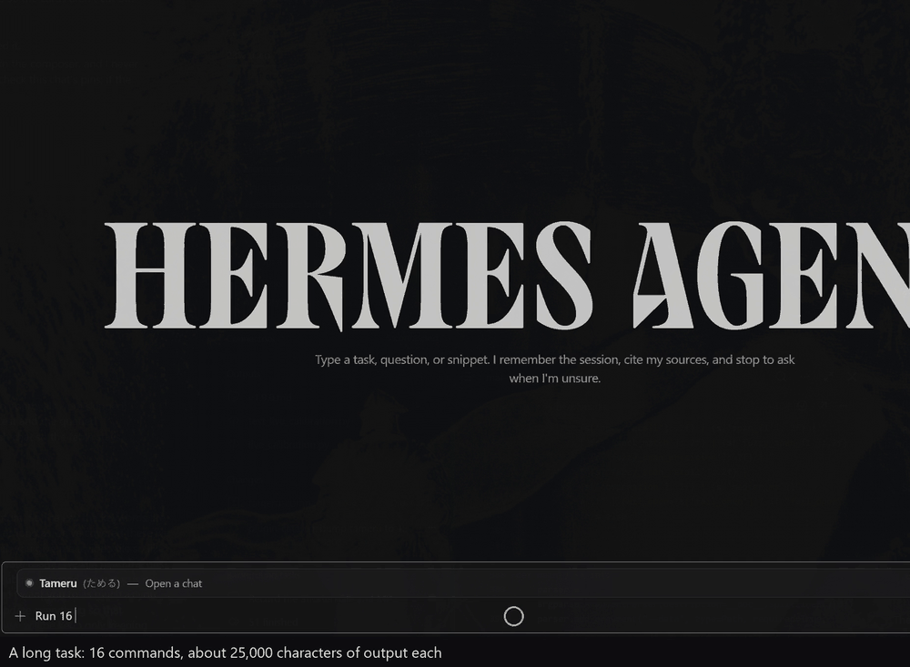

*A real run in Hermes Desktop (Claude Haiku 4.5): sixteen commands of about 25,000 characters each. Tameru shortens ten outputs and frees about 65K tokens, the answers stay correct, and Left Out shows what was removed. The recording is sped up and cropped to the chat and the panel.*

## What's new in 1.9.0

- **Pinned instructions.** `/tameru pin TEXT` keeps a line you wrote word for word in every Hermes summary of the chat.
- **Keep and Restore.** Show the model a shortened output in full again, for a few replies or until you unpin it. Saved history is never edited.
- **A Desktop panel with a Left Out viewer.** A gauge, a table of every cleanup, and a line-by-line view of what was removed.
- **Adaptive compaction by default.** The prune trigger follows the model's window and tunes itself from live signals, within bounds.
- **An Artifact Trail in every summary.** Files touched, commands with their last exit code, and one line per distinct error survive each Hermes summary.
- **A sturdier engine.** Structured reports (SARIF, notebooks, Kubernetes, Git, LCOV, JUnit) stay whole, ambiguous input returns the exact original, and the credential screen is about twice as fast on a large log.

Full details: [1.9.0 release notes](docs/releases/v1.9.0.md) and the [changelog](CHANGELOG.md).

[Why Tameru](#why-tameru) · [Pin your rules](#pin-the-lines-that-must-survive) · [Adaptive compaction](#adaptive-compaction) · [See it work](#see-it-work) · [Commands](#commands) · [Install](#install) · [Engine results](#engine-results) · [Documentation](#documentation)

## Why Tameru

| You want to… | Tameru gives you… |
|---|---|
| Keep a rule alive through a long task ("never touch the production config", "use the staging database") | **Pinned instructions**: up to five lines, kept word for word in every compaction summary of that chat. |
| Stop re-paying for the same 600-line log on every turn | **Shortened tool output**: a query-aware extract that keeps every distinct error, with the original one call away. |
| Trust that nothing important was thrown away | **Recoverable originals**, **Keep** and **Restore**, and a **Left Out** viewer that shows each removed stretch. |
| Let a long session run for hours without it drifting | An **Artifact Trail** in every summary (files, commands and exit codes, errors) so the agent knows what it already did. |
| See what it is doing to your chat | A live **panel**, `/tameru stats`, and honest labels (freed context is not a bill). |
| Switch it off without ceremony | `enabled: false` is stock Hermes, byte for byte. |

Also worth knowing:

- **Safe by default.** Output that looks like a credential is never stored. Web, browser and MCP results stay marked as untrusted data. When the engine is unsure, it returns the original text.
- **No new bill.** Tameru adds no model calls. The default engine is deterministic: about 3 ms for a typical input, the same answer every run.
- **Works in your language.** Script-aware matching is tested across 20 script and language families, including Japanese, Chinese and Arabic.
- **Not locked to one agent.** The engine is a Python function, a CLI and a transcript adapter for any harness.

## Pin the lines that must survive

Every compaction is a chance for the agent to forget something you told it. A summariser decides what matters, and a rule stated once, early, is exactly what tends to be
softened or dropped. Pinning takes that decision away from the summariser.

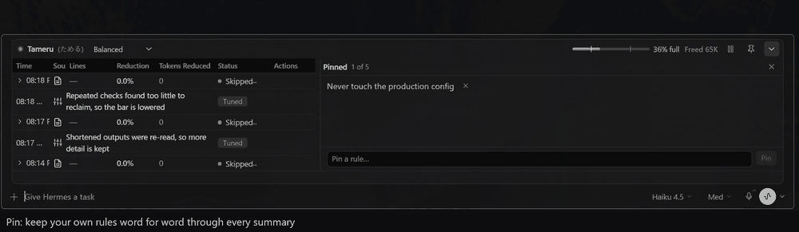

```text
/tameru pin Never touch the production config
/tameru pin Use the staging database, db-eu-staging
/tameru pins            # list them
/tameru unpin 1         # remove one
```

- **Word for word, every time.** Pins are added to every Hermes summary of the chat under a `## Pinned by you (Tameru, verbatim)` heading, so the summariser cannot reword them.
- **Yours alone.** Nothing is ever pinned for you and nothing is inferred. Text that looks like a credential is refused.
- **Two ways in.** Type `/tameru pin TEXT`, or use the pin button in the Desktop panel, which opens the list with a box to add a rule and an x to remove one.
- **Bounded.** Up to 5 lines, 300 characters each, 1,500 together. They are saved with the chat, and `/tameru unpin N` removes one.
- **Outputs too.** **Keep** does the same for a tool output: pin it from the panel (or `/tameru keep REF`) and the model sees it in full on every reply until you unpin it.

Pinning is a mechanism, not a benchmark: this repository does not claim a measured accuracy gain from it. What it guarantees is that your lines are present in the summary, verbatim.

## Adaptive compaction

Tameru does not shrink everything all the time. It watches the session and acts when acting pays.

1. **Hermes decides when to compact; Tameru decides what to keep.** The plugin works inside Hermes' own gates, so the usual safety rules still apply.
2. **It prunes early, in proportion to the window.** The first prune fires before Hermes would compact (on a 128K window at 72,000 tokens, where Hermes compacts at 96,000; the trigger is derived from the model's window), and a repeat prune only goes ahead if it brings the prompt well down, so it is worth breaking the prompt cache.
3. **It tunes itself from four signals**: Hermes summarising before Tameru acted, repeated checks that found too little to reclaim, the model re-reading a shortened output, and context refilling quickly after a cleanup. Steps are small and bounded, calm stretches relax it, and the only choices left to you are a bias (**Save space**, **Balanced**, **Preserve detail**) and **Pause**.
4. **What survives a summary is exact, not paraphrased**: your pins, the Artifact Trail, and at least one line of every distinct error template.
5. **Any cut can be undone.** Each shortened output names its original; the agent reads any line range back with `tameru_read_original`, and you can Restore or Keep it from the panel.

Measured against stock Hermes in a replay of scripted agent sessions (mean cost, negative is cheaper): **-0.6% at 64K, -7.2% at 128K, -7.4% at 200K** windows. It is not free everywhere: at 64K it roughly breaks even, a session that never reaches a compaction costs about 2% more, and many small results cost a little more. A live heavy-output task on Hermes Desktop cost 18.5% less than stock (2 sessions against 3; live runs cannot resolve a few percent). The plugin README lists [every case where Tameru costs more](https://github.com/0xWhiteMage/hermes-tameru-plugin#at-a-glance).

## See it work

**Shorten.** Bulky output shrinks as the chat grows, and every removed stretch stays inspectable.


**Restore.** Click the arrow on a shortened output; with your next message the model sees the full original again, for its next few replies. Saved history is never edited.

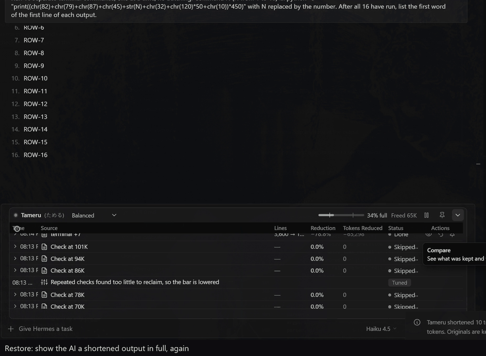

**Keep.** Click the pin on a row and the output stays in front of the model on every reply until you unpin it.

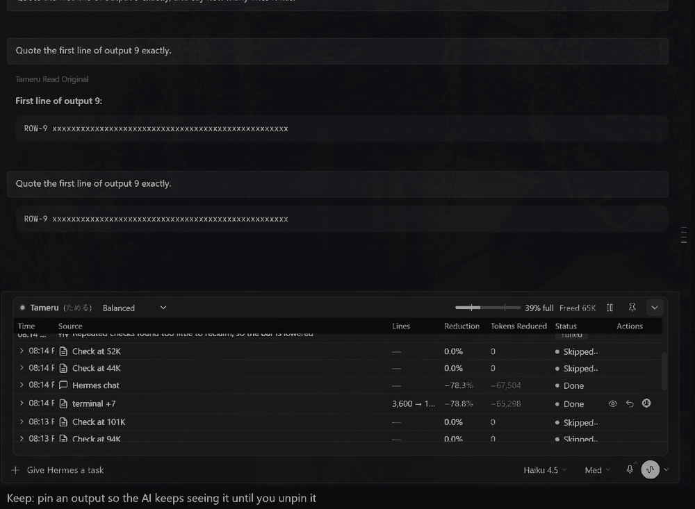

<details>
<summary><strong>More recordings: Left Out viewer, lean modes, row details, commands</strong></summary>

**Left Out.** Kept lines show normally; each removed stretch folds into one bar. Click a bar to read it, then **Add** (small, trusted text) or **Re-Read** (large text, or when you would rather the agent fetch it). Both only fill your message box; nothing is sent until you send it.

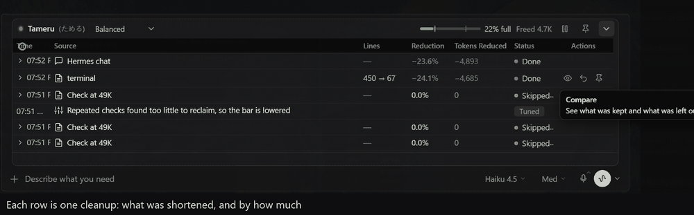

**Lean mode.** Save space, Balanced or Preserve detail, per chat.

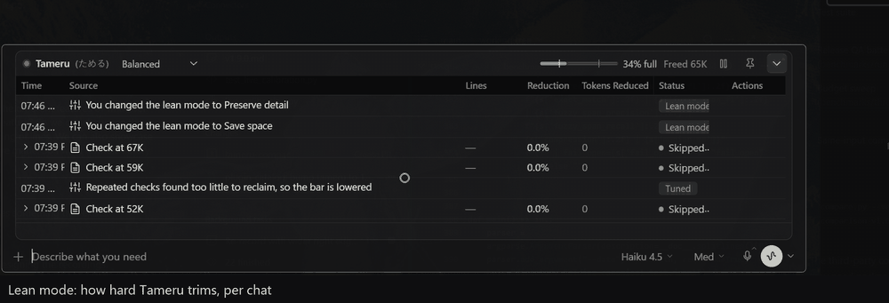

**Row details.** Method, lean mode, tokens in and out, duration and whether the original is available.

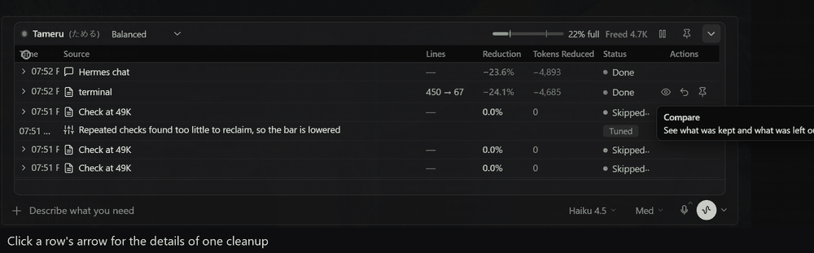

**The panel and its hover cards.** About 30 px when closed, a fixed height when open, with an explanation on every control.

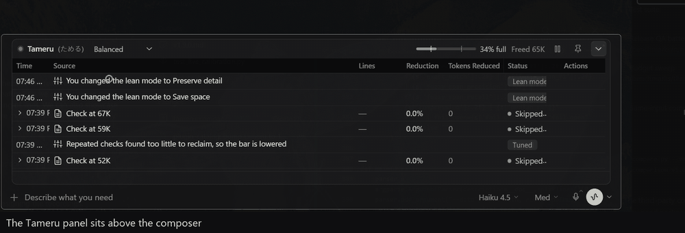

**Collapse.** One click folds the panel to a thin bar and another opens it.

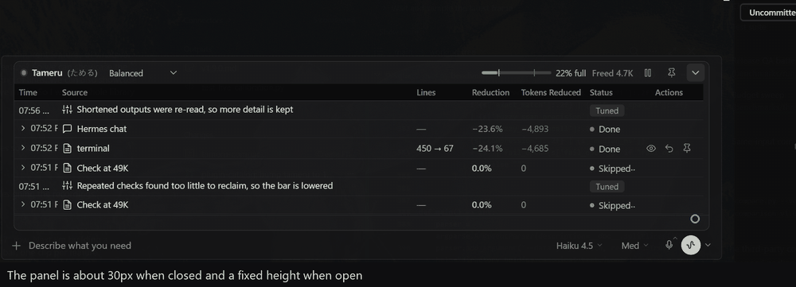

**Commands.** `/tameru` and `/tameru help`, then `/tameru stats`.

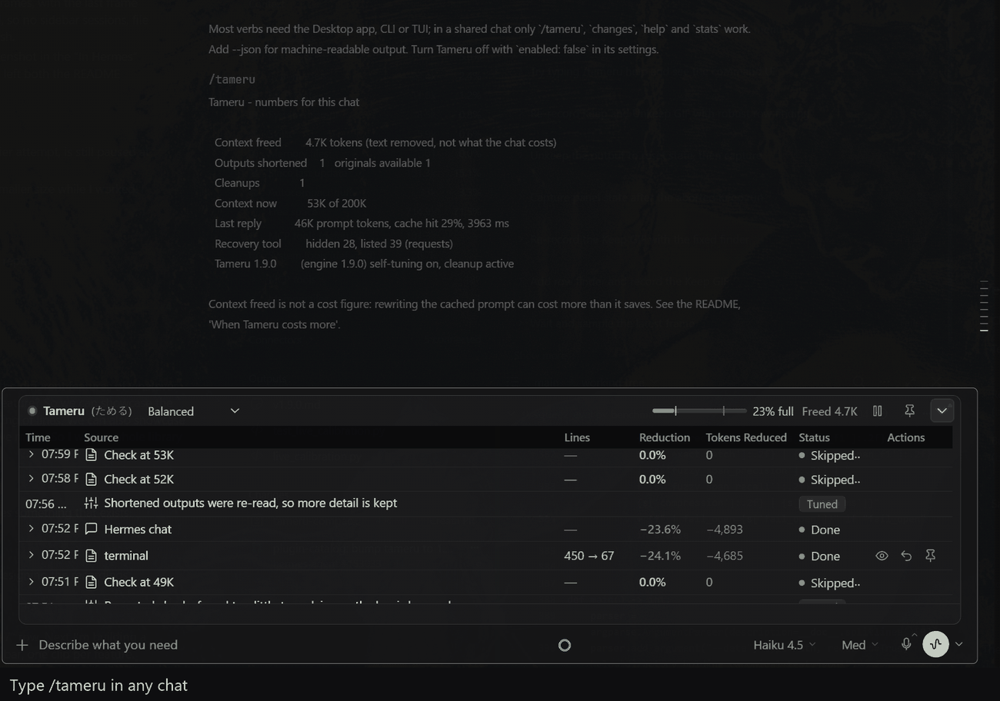

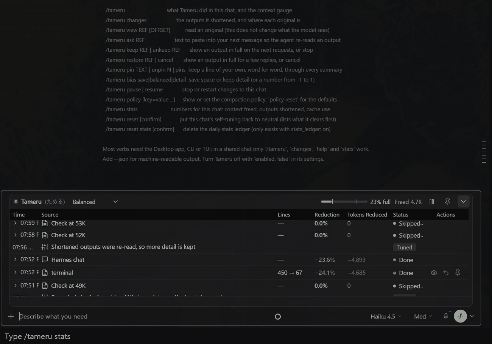

</details>

**And the engine on its own**, on a sample Gradle build log:

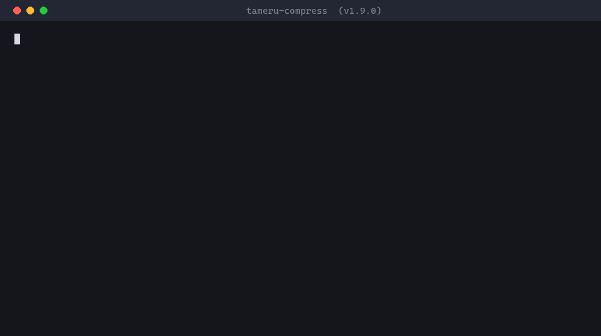

*Recorded output of the real engine (rendered by [`scripts/render_demo_gif.py`](scripts/render_demo_gif.py) from what `compress_context` returns): 200 lines in, 20 out, 93% fewer tokens, and the failing test, its assertion and the build result are all still there.*

## Commands

**In Hermes**, with the [plugin](https://github.com/0xWhiteMage/hermes-tameru-plugin) installed, type these in any chat:

| Command | What it does |
|---|---|
| `/tameru` | What Tameru did in this chat, and the context gauge. |
| `/tameru help` · `/tameru stats` | Every verb in one line each · numbers for this chat (context freed, outputs shortened, cache use). |
| `/tameru changes` | The outputs it shortened, and where each original is. |
| `/tameru view REF [OFFSET]` · `/tameru ask REF` | Read an original · text that makes the agent re-read an output. |
| `/tameru keep REF` · `/tameru restore REF` · `/tameru unkeep REF` · `/tameru cancel` | Show an output in full: until you unpin it, for a few replies, or stop. |
| `/tameru pin TEXT` · `/tameru pins` · `/tameru unpin N` | Keep a line of your own, word for word, through every summary. |
| `/tameru bias save\|balanced\|detail` · `/tameru pause` · `/tameru resume` | Save space or keep detail; stop or restart changes to the chat. |
| `/tameru reset [confirm]` | Put the chat's self-tuning back to neutral (lists what it clears first). |

**Command line** (`tameru-compress`, installed with the package):

```bash
tameru-compress build.log "Why did the build fail?" --no-ccr
tameru-compress build.log "Why did the build fail?" --no-ccr --stats    # JSON diagnostics, then ---, then the extract
cat build.log | tameru-compress - "Find the active error" --no-ccr        # read stdin
tameru-compress notes.md "What is the backup host?" --mode fixed --budget-ratio 0.3 --no-ccr   # ask for a smaller extract
```

| Option | What it does |
|---|---|
| `--no-ccr` / `--ccr` | Turn the reversible recovery store off or on (on by default). |
| `--citations` / `--no-citations` | Mark dropped blocks with a citation (on by default). |
| `--stats` | Print JSON diagnostics (tokens, savings, risk, verifier), then `---`, then the extract. |
| `--mode {adaptive,fixed,compiler,precision}` and `--budget-ratio R` | Ask for a smaller extract; lower ratios request less text. |
| `--strategy {clear,extract,summarise,auto}` | `extract` (default, no model), `clear` (drop tool payloads), `auto` (extract, escalate only if extraction fails open). |
| `--pin-recent N` | Always keep the first block and the newest N blocks. |
| `--min-savings-ratio R` | Return the original when the achieved savings fall below this ratio (0 disables). |
| `--derive-query` | On an empty or generic query, infer a conservative objective from recurring rare terms instead of failing open. |

## Install

Requires **Python 3.10+**.

### In Hermes

Install the maintained [hermes-tameru-plugin](https://github.com/0xWhiteMage/hermes-tameru-plugin) by following its instructions, then select the engine:

```yaml
context:
  engine: tameru
```

The plugin vendors this engine, so updating the plugin updates the engine. It is listed in the Hermes plugin catalogue; the update to plugin 1.9.1 is [Hermes PR #153033](https://github.com/NousResearch/hermes-agent/pull/153033), open and awaiting review. To turn Tameru off for a chat or everywhere, set `enabled: false` in its settings: Hermes then behaves as stock.

### The engine on its own

Install the verified **1.9.0** source, pinned to its commit:

```bash
python -m pip install "git+https://github.com/0xWhiteMage/tameru-compaction-system.git@9f1f1c4"
```

That commit is the engine code of 1.9.0 (later commits change documentation only). No release tag, GitHub Release page or PyPI package is published yet.

```python
from tameru.compress_context import compress_context

archive = "\n\n".join(
    f"Routine archive section {i}: ordinary status record with no relevant operational facts."
    for i in range(30)
)
context = (
    archive
    + "\n\nProject Orion uses warehouse Cedar.\n\n"
    + "Cedar routes writes through endpoint DB-EU-7.\n\n"
    + archive
)
result = compress_context(
    context,
    "Which database endpoint does Project Orion use?",
    ccr=False,
    citations=False,
)
print(result.compressed_text)
print(f"Estimated token savings: {result.tokens_saved_pct:.1f}%")
```

Supply the task's question alongside the source text. The example uses the default extractive strategy and disables recovery persistence: 5,342 characters in, 266 out (95.0% fewer tokens), with the two linking facts (**Project Orion → warehouse Cedar → endpoint DB-EU-7**) intact. [API options and receipts →](docs/USAGE.md)

For another agent framework, start with the Python API, CLI or generic transcript adapter. The [integration guide](docs/INTEGRATION.md) covers message lists, task-derived queries and keeping vendored copies current.

## How the two repositories fit

**This repository is the engine**, and it runs on any agent harness. It has no dependency on Hermes or any other host. The
[Hermes plugin](https://github.com/0xWhiteMage/hermes-tameru-plugin) is a separate repository that vendors this engine unchanged and adds everything Hermes-specific: the
adaptive policy and self-tuning, pinned instructions, Keep and Restore, the Artifact Trail, the Desktop panel and the `/tameru` commands. Engine changes land here first.
See the [repository guide](docs/REPOSITORIES.md).

## Engine results

<!-- tameru:headline:start -->

| Mean characters saved | Required strings retained | Forbidden strings retained | Median wall time |
|:---:|:---:|:---:|:---:|
| **82.4%** | **25/25** | **0** | **3.05 ms** |

Measured on Tameru **1.9.0** on **16 shared task cases**, 2026-11-11 (Windows 11, Python 3.13, CPU only). These are source-evidence checks on Tameru's regression corpus; agent answer accuracy and model-token costs are outside this evaluation.

<!-- tameru:headline:end -->

<!-- tameru:comparison:start -->

**Same input. Same query. Same 16 tasks**, covering documents, configuration, Git/npm/YAML output, multilingual text, saturated grep, captured pytest and numbered-source cases (Windows 11, Python 3.13, 1 warmup and 5 timed calls per case):

| Method | Required strings kept | Forbidden strings ↓ | Clean cases | Mean chars saved ↑ | Median wall time ↓ |
|---|---:|---:|---:|---:|---:|
| **Tameru v1.9.0** | 25/25 | 0 | 16/16 | 82.4% | 3.05 ms |
| TF-IDF paragraph baseline | 22/25 | 5 | 9/16 | 53.4% | 0.10 ms |

**A clean case keeps every required string and excludes every planted forbidden string.** Savings are the arithmetic mean per case; wall time is the median of per-case medians.
Third-party methods (LCC, Headroom, Laya) were measured on an earlier release, have not been re-run for 1.9.0, and are reported separately in the [full comparison](benchmarks/COMPARISON.md).

[Complete comparison and per-task results →](benchmarks/COMPARISON.md) · [1.9.0 run, raw →](benchmarks/comparison-v1.9.0.json)

<details>
<summary><strong>Evaluation details: corpus, methods, timing and limits</strong></summary>

**Corpus.** All scored methods see identical text and task queries. The 16 cases include 25 required source strings plus planted stale, excluded or distracting strings. The large synthetic performance case and empty-query case belong to the separate release QA battery.

**Metrics.** Required strings must survive every output; a forbidden string in any output counts as a leak. Character savings measure text length, rather than model tokens or monetary cost. These checks cover specified fixture evidence and do not measure downstream agent answers or every possible semantic loss.

**Methods.** Tameru uses default extraction with `ccr=False`, `citations=True`. TF-IDF is a simple paragraph-retrieval baseline.

**Timing.** One untimed warmup and 5 timed complete calls per case. Parsing, scoring and rendering are inside the timer; imports are outside it. Hardware and scheduling affect latency. Tameru remembers analyses of repeated identical text, so this repeat-timing protocol flatters it.

**Runtime and provenance.** Python 3.13.17 on Windows 11 (AMD64, 16 logical CPUs), engine commit `cab2edc`; package versions and every timing sample are in `benchmarks/comparison-v1.9.0.json`.

**Interpretation.** This is Tameru's own regression corpus, including adversarial fixtures. Broader independent and live-agent evaluations are still needed to establish generality.

</details>

<!-- tameru:comparison:end -->

### Where the engine helps

| Your agent is reading… | Tameru focuses on… |
|---|---|
| Pages of logs around a failure | Error fingerprints, relevant messages, hosts and ports |
| Search results repeating the same name | Matching definitions and assignments, distinct matches and file context |
| A failed test with long captured output | The failure, recognised errors, warning-or-higher lines and section boundaries |
| Configuration containing an old value and a later override | The current value and its qualifier when supersession is explicit |
| A document with an answer spread across sections | Related entities and the source facts linking them |
| Git history, JSON, CSV or YAML dumps | Relevant records with enough structure to interpret them |

<details>
<summary><strong>Formats and languages</strong></summary>

| Input | Handling |
|---|---|
| Terminal and build logs | ANSI handling, repeated-template reduction, structured (logfmt/JSON) levels, error exemplars and last-occurrence retention |
| Numbered source reads | `cat -n` and common `read_file` gutters; code stays recognisable |
| Unified diffs and grep/rg | Hunk or file grouping, query matches, headers and saturated-query selection |
| Pytest (incl. quiet mode), Jest, Go, Cargo, Gradle, RSpec, PHPUnit, dotnet test, Maven Surefire | Failure evidence and summaries, with conservative handling of unknown surrounding lines |
| kubectl output | `describe`, `get events`, `get pods`, `top` and `rollout status` reducers; events collapsed and only abnormal node Conditions kept |
| Linux, macOS and Windows tool output | syslog/journal/dmesg, macOS unified log, `ps aux`, `top`, `vmstat`, `df`, `ping`, `traceroute`, `netstat`, `nmap`, `ipconfig /all`, `systeminfo`, PowerShell tables and error records, msiexec logs and `sysctl`/`pg_settings` listings: normal rows fold, outliers and failures stay |
| Build, package and container tools | Docker build, `docker ps`/`docker compose ps`, Terraform plans, Ansible, CMake, cargo, bundlers, pip/npm/yarn/composer installs, `npm ls`, `npm audit`, `pip freeze`, `apt`, lint and type checkers |
| Service logs | nginx, Apache, Redis, PHP, MySQL slow query, HAProxy, klog, web access logs and logfmt |
| Structured reports | SARIF findings, notebook cells, Kubernetes identity and status, whole Git log entries and patches, LCOV records, JUnit testcases: selected records keep their raw byte spans |
| JSON/NDJSON and CSV/TSV | Query-aware records, quote-aware framing, headers, and summaries (one example, unusual and matching records, a count) for large arrays, JSON Lines and tables |
| Markdown | Heading ancestry, fenced-code protection and outlier rows for large pipe tables |
| YAML, XML/HTML, SQL, INI/TOML-style sections | Conservative format-specific selection; ambiguous shapes can decline specialised reduction |
| Text extracted from OCR or vertical layouts | Matching in logical source order; text extraction happens upstream |

Script-aware matching has regression coverage across **20 script/language families**, including Japanese, Chinese and Arabic release cases. Matching uses a normalised shadow while extracts retain the source text. Accented query words stay whole, question words and generic asks count as filler in 20 languages besides English, and the opt-in no-query `prose_brief` splits sentences in Latin scripts, CJK, Thai, Devanagari and Arabic so templated repeats can fold. Coverage varies by language and task; Tameru accepts text and relies on upstream tools for OCR.

</details>

### Release QA battery

The separate **15-case release QA battery passes every case** on v1.9.0. All required answer strings survive, and no planted forbidden strings leak. These figures use **estimated tokens**, whereas the comparison above measures **characters**.

| Workload | Evidence checked | Estimated token savings |
|---|---|---:|
| **Documents and configuration** | | |
| Lexical distractor | Required backup host; distracting glossary excluded | **96.7%** |
| Multi-hop document | Endpoint linked through its warehouse | **95.0%** |
| Release evidence chain | Release alias, deployment identifier and checksum | **95.6%** |
| Current configuration | New timeout; explicitly superseded value excluded | **90.1%** |
| Negation and override | “Not enabled”; obsolete enabled state excluded | **92.5%** |
| Ambiguous configuration | Required value retained without an explicit supersession marker | **88.4%** |
| Excluded sample | Operational host; excluded example absent | **87.3%** |
| YAML configuration | Distro and language; excluded dependency absent | **76.0%** |
| **Agent tool outputs** | | |
| Git history | Required commit hash | **94.0%** |
| npm log | Requested Playwright version | **31.0%** |
| **Multilingual text** | | |
| Japanese document | Required layer count | **46.8%** |
| Chinese needle case | Required backup host | **90.9%** |
| Arabic needle case | Required backup host | **88.6%** |
| **Robustness** | | |
| Large synthetic document | Savings, repeatability and timing; no answer-string check | **99.9%** |
| Empty query | Original input returned | **0.0%** |

The 4,000-record synthetic document completed in about **140 ms wall time** (the gate is 1,200 ms). Its maximum saving is specific to that input. Token counts use Tameru's estimator; savings with a model's own tokenizer will vary. [Full release results →](benchmarks/production-qa-v3-results.json)

### Choose a context budget

Use `mode="fixed"` and `budget_ratio` to request a smaller extract. Lower ratios request a smaller budget for compressible content; pinned evidence can exceed that budget.

| `budget_ratio` | Mean character savings | Clean release cases |
|---:|---:|---:|
| 0.1 | **77.8%** | 15/15 |
| 0.2 | **69.9%** | 15/15 |
| 0.3 | **61.9%** | 15/15 |
| 0.5 | **41.7%** | 15/15 |
| 0.7 | **24.8%** | 15/15 |

Every operating point retained all required strings with no forbidden leaks in this corpus. Validate the evidence your own tasks need before choosing a ratio. [Replay the sweep →](benchmarks/threshold_sweep.py)

## Recovery and limits

**Recovery is optional.** The standalone API defaults to `ccr=True`; a successful store write can attach a pointer to the original context. Retrieval needs valid, unexpired records and a host that can follow that pointer. Set `ccr=False` when you do not want persistence or your host has no retrieval path.

**Evidence retention is task-dependent.** Extraction can miss relationships with no shared terms, and source lines impose a minimum output size. Weak queries, malformed input or insufficient savings can return the original text. Required-string checks measure fixture evidence, rather than an agent's final-answer accuracy.

<details>
<summary><strong>Storage, credentials and optional model paths</strong></summary>

Credential screening is heuristic. It gates recovery-cache writes; it does not redact returned text or encrypt the cache. A citation alone does not establish that an original was successfully stored.

The default `strategy="extract"` makes no LLM call. Optional `summarise`/`auto` strategies and semantic-model paths have separate dependencies and inference behaviour. Default extraction adds no LLM inference charge; local CPU work still consumes resources.

The [usage guide](docs/USAGE.md) explains budgets, recovery, receipts, host markers, optional models and known limits.

</details>

## Reproduce the checks

```bash
python -m pip install -e '.[dev]'
python -m pytest -q
python benchmarks/run_battery.py
python benchmarks/threshold_sweep.py
python benchmarks/compare.py --verify-against benchmarks/comparison-v1.9.0.json
```

Verification (2026-11-11): **2,016 tests passed / 4 skipped** (plus 146 subtests), **15/15 release QA cases**, and the comparison run reproducing its recorded output with **0 differing fields** over the 16 cases. Timing tests depend on hardware; the battery rewrites its JSON with your local timings.

`compare.py --verify-against` exits non-zero if any output hash, saving or retention result differs; timings are not compared. `--render-from` regenerates the figures and tables in this section from a completed report of the same engine version. The [comparison report](benchmarks/COMPARISON.md#reproduce) lists the pins and commands for the third-party methods.

## Documentation

| Start here | Find out how to… |
|---|---|
| [Hermes plugin](https://github.com/0xWhiteMage/hermes-tameru-plugin) | Install Tameru in Hermes, configure it and read the cost measurements |
| [Usage and API](docs/USAGE.md) | Set budgets, inspect receipts, configure recovery and use advanced controls |
| [Repositories](docs/REPOSITORIES.md) | See what this engine repository owns and what the Hermes plugin repository owns |
| [Agent integration](docs/INTEGRATION.md) | Apply compaction in a host framework and keep vendored copies current |
| [Comparisons](benchmarks/COMPARISON.md) | Inspect every task, provider setting, timing sample and measurement limitation |
| [Release notes](docs/releases/v1.9.0.md) and [changelog](CHANGELOG.md) | Review this release's changes and the version history |
| [Red-team findings](benchmarks/redteam/FINDINGS-1.9.0.md) | Read what 228 adversarial cases found and what was fixed ([notes](benchmarks/redteam/NOTES-1.9.0.md)) |
| [Architecture](docs/ARCHITECTURE.md) | Understand the format adapters, Unicode handling and bounded-work limits |
| [Research digest](docs/RESEARCH.md) | Follow the research and ecosystem work behind the project |

## Credits and support

Built by **The White Mage**. Tameru (ためる) means “to store up”. Research and ecosystem acknowledgements, including LCC/JEV, Headroom, SelfCompact, PAACE, TPC, Compactor and ARC-style recovery, are recorded in the [research digest](docs/RESEARCH.md) and [changelog](CHANGELOG.md).

[Follow on X](https://x.com/0xWhiteMage) · [Support on Ko-fi](https://ko-fi.com/0xwhitemage) · [Report an issue](https://github.com/0xWhiteMage/tameru-compaction-system/issues) · [Contribute](https://github.com/0xWhiteMage/tameru-compaction-system/pulls)

Released under the [Apache License 2.0](LICENSE).
