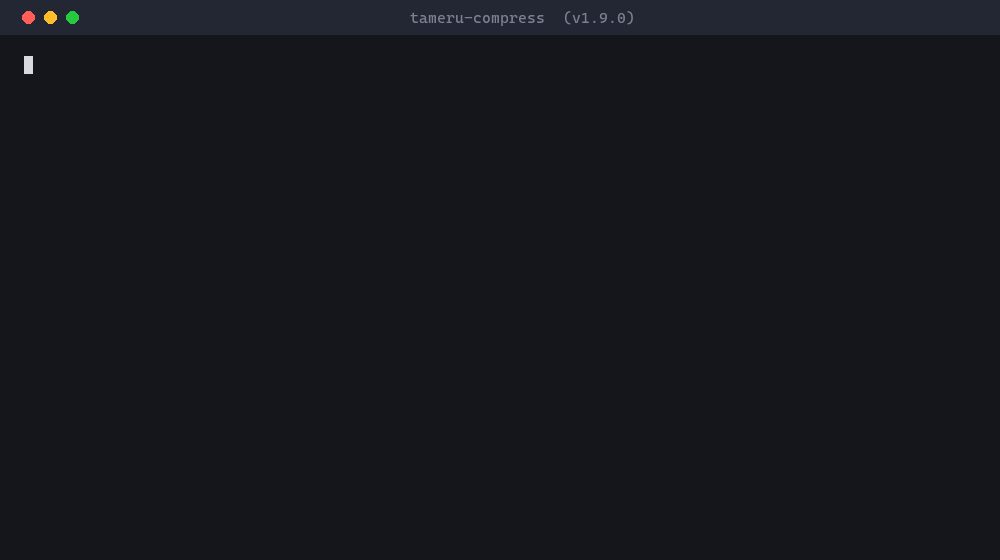

# Tameru (ためる)

<p align="center">
  <br><br>
  <a href="CHANGELOG.md"></a>
  <a href="pyproject.toml"></a>
  <a href="pyproject.toml"></a>
  <a href="LICENSE"></a>
  <a href="https://github.com/0xWhiteMage/tameru-compaction-system/releases"></a>
  <a href="https://x.com/0xWhiteMage"></a>
  <a href="https://ko-fi.com/0xwhitemage"></a>
</p>

**Deterministic, query-aware context compaction for long-running AI agents. Local, fail-open, with recoverable originals.**

Tool output is the expensive part of a long agent session: a 600-line build log stays in context and gets paid for on every later turn.
Tameru shortens that output to the part the task needs, keeps every distinct error, and hands back the original text whenever it is unsure.

- **Keep the evidence** — an extract chosen against your question, not a blind head-and-tail cut
- **No model bill** — no LLM call, no GPU, nothing beyond Python's standard library; ~5 ms for a typical log
- **Fail open** — ambiguous, malformed or low-saving input returns the exact original
- **Recoverable** — a cut can point to its original (optional, off by default in plugins), so the agent can read any stretch back



*Real engine output: 200 lines in, 20 out, 93% fewer tokens — failing test, assertion and build result all intact.*

[Install](#install) · [Quick start](#quick-start) · [Benchmarks](#benchmarks) · [Integrations](#integrations) · [Docs](#documentation) · [Contributing](#contributing)

## Install

Requires **Python 3.10+**. The engine itself has no dependencies beyond the standard library.

```bash
python -m venv .venv
. .venv/bin/activate  # Windows PowerShell: .venv\Scripts\Activate.ps1
python -m pip install "git+https://github.com/0xWhiteMage/tameru-compaction-system.git@v1.10.0"
```

Not on PyPI yet — install from the release tag. To use Tameru inside an agent harness, install its [plugin](#integrations) instead; the plugin brings its own copy of the engine.

## Quick start

### Python

```python
from tameru.compress_context import compress_context

result = compress_context(build_log_text, "Why did the build fail?")
print(result.compressed_text)          # the extract
print(f"{result.tokens_saved_pct:.0f}% fewer tokens")
print(result.receipt["verifier"])      # what the evidence check found
```

Pass the task's question along with the text. Ambiguous input, malformed data or thin savings return the original unchanged — you always get usable output. [Full API →](docs/USAGE.md)

### Command line

```bash
tameru-compress build.log "Why did the build fail?"
tameru-compress build.log "Why did the build fail?" --stats   # JSON diagnostics, then ---, then extract
cat build.log | tameru-compress - "Find the active error"
```

Key options: `--mode fixed --budget-ratio 0.3` (smaller extract) · `--strategy extract|clear|auto` · `--pin-recent N` · `--min-savings-ratio R` · `--no-ccr` (disable the recovery store) · `--derive-query`.

### Message lists

For an OpenAI-style transcript, `tameru.transcript.apply_extractive_tool_prune` prunes old tool results in place and leaves everything else alone. See the [integration guide](docs/INTEGRATION.md).

## Benchmarks

### vs other compressors

**Same input, same query, same 16 tasks** — documents, configuration, Git/npm/YAML output, Japanese/Chinese/Arabic text, saturated grep, captured pytest, numbered source reads. Measured 2026-11-22 on Tameru **1.10.0** (Windows 11, Python 3.13, CPU only, 1 warmup + 2 timed calls per case):

| Method | Required strings kept | Forbidden strings ↓ | Clean cases | Mean chars saved ↑ | Median wall time ↓ |
|---|---:|---:|---:|---:|---:|
| **Tameru v1.10.0** | **25/25** | **0** | **16/16** | **80.2%** | 5.05 ms |
| TF-IDF paragraph baseline | 22/25 | 5 | 9/16 | 53.4% | 0.11 ms |
| Headroom TextCrusher | 21/25 | 4 | 9/16 | 50.5% | 0.38 ms |
| LCC mechanical | 25/25 | 5 | 11/16 | 36.3% | 6.38 ms |
| LCC → Laya (RTX 4080, CUDA) | 25/25 | 5 | 11/16 | 8.0% | 61.8 ms |

A **clean case** keeps every required string and excludes every planted forbidden string. Tameru is the only method here that leaked nothing and kept everything — and the only one that is a pure function of its input. Full per-task table, environment pins and every timing sample: [COMPARISON.md](benchmarks/COMPARISON.md).

<details>
<summary><strong>Methodology and limits</strong></summary>

This is Tameru's own regression corpus, including deliberately adversarial fixtures — not an independent evaluation. String retention cannot catch every semantic loss, and extractive output has a source-line size floor. Repeat timing favours Tameru's analysis memoisation. Measure your own workload before choosing a budget.

</details>

### vs Tameru 1.9.0 (sealed holdout)

94 unseen cases paired against engine 1.9.0 — cluster bootstrap, one sealed look ([full results →](docs/RESULTS-1.10.0.md)):

| Question type | Saved, 1.10.0 | vs 1.9.0 | Evidence kept |
|---|---:|---:|---:|
| Generic | 76.9–80.2% | +13.7 to +63.7 pts | 98.9–100% |
| Tool-call-shaped | 76.6–76.7% | +11.2 to +17.0 pts | 99.5% |
| Task | 86.0–86.6% | +6.5 to +21.7 pts | 98.9–100% |

Fallback-to-original rate dropped from 83% to 13.8% on the generic question. Stack traces: 84–89% saved with all evidence kept.

### Latency (1.10.0, p50 across all profiles)

| Input size | Median | Worst case |
|---|---:|---:|
| 6–20K chars | 40 ms | 54 ms |
| 50K | 114 ms | 139 ms |
| 200K | 367 ms | 436 ms |
| 2M | 211 ms | 535 ms |
| 4M | 4.1 s | 9.3 s (bounded sample) |

## How it works

1. **Size guard** — over 8M chars returns the original; over 2M analyses a bounded sample
2. **Format adapters** — logs, diffs, test output, kubectl, JSON/CSV, SARIF and ~30 more shapes get structure-aware handling; unknown shapes fall back to generic scoring
3. **Query-aware scoring** — each block is scored against the question plus structural signals (errors, fingerprints, assignments)
4. **Extract + verify** — the extract is checked for dropped evidence before it ships; credentials never reach the recovery store
5. **Receipt + recovery** — per-call diagnostics (tokens, savings, verifier result) and an optional pointer to the stored original

Deterministic: same input, same output, every run.

## Integrations

The engine is harness-agnostic. Each plugin lives in its own repository and vendors this engine unchanged — plugin cost measurements are taken against that harness's stock behaviour.

| Harness | Plugin | Status |
|---|---|---|
| [Hermes Agent](https://github.com/NousResearch/hermes-agent) | [hermes-tameru-plugin](https://github.com/0xWhiteMage/hermes-tameru-plugin) | **v1.9.1** released · engine-1.10.0 update on `feat/engine-1.10.0` |
| [DeepSeek Harness](https://github.com/deepseek-ai/deepseek-harness) | [dsh-tameru-plugin](https://github.com/0xWhiteMage/dsh-tameru-plugin) | v0.2.0, in development (Beta) |

Writing your own: [harness plugin guide](docs/INTEGRATION.md#4-writing-a-harness-plugin) · [what each repo owns](docs/REPOSITORIES.md).

## Limits

- **Extraction, not summarisation.** The default strategy never calls a model — it selects source lines. Optional `summarise`/`auto` paths exist but are opt-in and use your configured endpoint.
- **Evidence retention is task-dependent.** Extraction can miss relationships that share no terms; weak queries and thin savings return the original.
- **Credential screening is heuristic.** It gates recovery-store writes and opt-in redaction — it is not a DLP product.
- **Replay numbers, not bills.** Benchmarks measure characters/tokens and wall time on recorded inputs; whole-session cost and answer quality are measured in the plugin repos, and no live-model claim is made here.

## Documentation

| I want to… | Go to |
|---|---|
| Use the API, budgets, receipts, recovery | [docs/USAGE.md](docs/USAGE.md) |
| Integrate with a harness / write a plugin | [docs/INTEGRATION.md](docs/INTEGRATION.md) |
| See every benchmark measurement | [benchmarks/COMPARISON.md](benchmarks/COMPARISON.md) |
| Read the full 1.10.0 results & limits | [docs/RESULTS-1.10.0.md](docs/RESULTS-1.10.0.md) |
| Understand the architecture | [docs/ARCHITECTURE.md](docs/ARCHITECTURE.md) |
| Know the plugin safety rules | [docs/HOST-RESTRICTIONS.md](docs/HOST-RESTRICTIONS.md) |
| See what's new | [CHANGELOG.md](CHANGELOG.md) |

## Reproduce

```bash
python -m pip install -e '.[dev]'
python -m pytest -q          # 3,032 tests
python scripts/check_host_rules.py
python benchmarks/run_battery.py
python benchmarks/compare.py # re-run the comparison table (see COMPARISON.md for third-party pins)
```

## Contributing

Bug reports with a small failing input, fixes, new tool-output formats with real samples, and documentation are all welcome — start with [CONTRIBUTING.md](CONTRIBUTING.md). The engine runs inside other people's harnesses, so pull requests must respect the [host restrictions](docs/HOST-RESTRICTIONS.md), which CI checks. Report security problems privately via [SECURITY.md](SECURITY.md); reporters are credited in the changelog.

## Credits

Built by thewhitemage. *Tameru* (ためる) means "to store up". Research acknowledgements — LCC/JEV, Headroom, SelfCompact, PAACE, TPC, Compactor and ARC-style recovery — are in [docs/RESEARCH.md](docs/RESEARCH.md).

[Follow on X](https://x.com/0xWhiteMage) · [Ko-fi](https://ko-fi.com/0xwhitemage) · [Issues](https://github.com/0xWhiteMage/tameru-compaction-system/issues) · [Apache-2.0](LICENSE)
